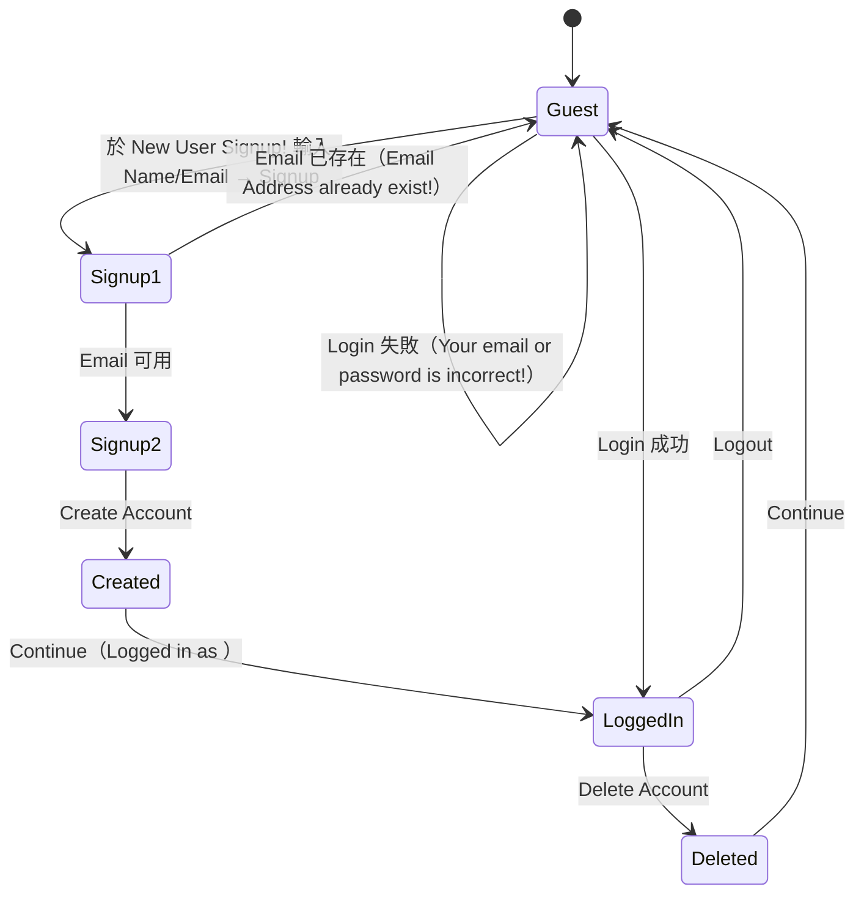

# PRD：Automation Exercise 會員流程（Register / Login / Logout）

> **版本**：v0.1（Reverse-engineered）
> **來源**：5 個 Test Case 的逐步操作——Register User、Login correct、Login incorrect、Logout、Register existing email
> **URL**：http://automationexercise.com
> **觀察**：2026-10-14 以 `playwright-cli` 對 live 站逐流程走查（含實際建立再刪除一個臨時帳號），截圖見 `screenshots/`
> **說明**：本檔只涵蓋會員（ACC）的註冊／登入／登出／刪除，與 `prd.md` §4.1 同一模組，可互相對照。文案以實際觀察到的**文字內容**為準，並註記 CSS 大寫顯示的差異。

## 1. 範圍

| In Scope | Out of Scope |
|---|---|
| 註冊（Name+Email → 帳號資訊 → 建立）、以正確／錯誤帳密登入、登出、重複 Email 防護、刪除帳號 | 商品、購物車、結帳、付款、發票、訂閱、忘記密碼、編輯會員資料、Email 驗證信 |

## 2. 使用者角色

| 角色 | 狀態識別（Header） | 可執行動作 |
|---|---|---|
| 訪客（Guest） | 顯示 `Signup / Login`（連到 `/login`） | 註冊、登入 |
| 會員（LoggedIn） | 顯示 `Logged in as <name>`、`Logout`、`Delete Account` | 登出、刪除帳號 |

## 3. 資訊架構（相關頁面與元件）

- **全站 Header**：訪客顯示 `Signup / Login`；會員顯示 `Logged in as <name>` 與 `Logout`、`Delete Account`（皆為 `/login`、`/logout`、`/delete_account` 連結）。
- **`/login`（單頁兩塊）**：上半 `Login to your account`（Email Address、Password、`Login`），中間 `OR`，下半 `New User Signup!`（Name、Email Address、`Signup`）。
- **帳號資訊頁**（Signup 送出後）：`Enter Account Information` 區塊 + `Address Information` 區塊 + `Create Account`。
- **結果頁**：`Account Created!` 與 `Account Deleted!`，各有一個 `Continue` 連結。

## 4. 功能需求

> 編號沿用 `prd.md` 的 `FR-ACC-*`；`TCr-Sn` 指本檔來源清單第 r 個 Test Case 的第 n 步。

### FR-ACC-01 註冊 Step 1：Name + Email
- `/login` 的 `New User Signup!` 區塊含 Name、Email Address 欄位與 `Signup` 按鈕。
- **AC**
  1. 輸入 Name 與**未註冊**的 Email，點 `Signup` → 進入 `Enter Account Information` 頁。(TCr1-S4~S7)

### FR-ACC-02 註冊 Step 2：帳號資訊 + 地址資訊
- **帳號資訊**：Title（`Mr.` / `Mrs.` radio）、Name、Email、Password、Date of Birth（Day / Month / Year 三個下拉）。
  - Email 由 Step 1 帶入且**唯讀（disabled）**。
  - Mail opt-in checkbox：`Sign up for our newsletter!`、`Receive special offers from our partners!`。
- **地址資訊**：First name、Last name、Company、Address、Address 2、Country（下拉）、State、City、Zipcode、Mobile Number。
- **AC**
  1. 點 `Create Account` → 顯示 `Account Created!` 頁（含 `Congratulations! Your new account has been successfully created!`）。(TCr1-S9~S14)
  2. 點 `Continue` → 回到已登入狀態，Header 顯示 `Logged in as <name>`。(TCr1-S15~S16)

### FR-ACC-03 重複 Email 防護
- **AC**：以已註冊 Email 於 `New User Signup!` 點 `Signup` → 顯示錯誤 `Email Address already exist!`，且**不**進入帳號資訊頁。(TCr5-S4~S8)

### FR-ACC-04 登入
- `/login` 的 `Login to your account` 區塊含 Email Address、Password 與 `Login` 按鈕。
- **AC**
  1. 正確帳密 → Header 顯示 `Logged in as <name>`。(TCr2-S4~S8、TCr4-S4~S8)
  2. 錯誤帳密 → 顯示錯誤 `Your email or password is incorrect!`，停留在 `/login`。(TCr3-S4~S8)

### FR-ACC-05 登出
- **AC**：點 Header 的 `Logout` → 回到 `/login`（可見 `Login to your account` / `New User Signup!`），狀態為訪客。(TCr4-S9~S10)

### FR-ACC-06 刪除帳號
- 會員可於 Header 點 `Delete Account`。
- **AC**：顯示 `Account Deleted!` 頁（含 `Your account has been permanently deleted!`），點 `Continue` 後離開已登入狀態（Header 再現 `Signup / Login`）。(TCr1-S17~S18、TCr2-S9~S10)

## 5. 關鍵流程

## 6. 訊息文案清單（Verbatim，供驗收比對）

| 情境 | 文字內容（DOM text） | 備註（畫面顯示） |
|---|---|---|
| 登入區標題 | `Login to your account` | 顯示同文字 |
| 註冊區標題 | `New User Signup!` | 顯示同文字 |
| 帳號資訊頁標題 | `Enter Account Information` | CSS 上色為全大寫 `ENTER ACCOUNT INFORMATION` |
| 地址區標題 | `Address Information` | 顯示同文字 |
| 註冊成功標題 | `Account Created!` | CSS 全大寫 `ACCOUNT CREATED!` |
| 註冊成功說明 | `Congratulations! Your new account has been successfully created!` | |
| 登入狀態 | `Logged in as <name>` | 例：`Logged in as OC QA` |
| 登入失敗 | `Your email or password is incorrect!` | |
| Email 重複 | `Email Address already exist!` | |
| 刪除成功標題 | `Account Deleted!` | CSS 全大寫 `ACCOUNT DELETED!` |
| 刪除成功說明 | `Your account has been permanently deleted!` | |

> 註：Jev 核對時，`Enter Account Information` / `Account Created!` / `Account Deleted!` 的文字內容為 title case，畫面因 CSS `text-transform` 呈全大寫；自動化斷言兩者皆可，但建議以可及名稱（title case）為準。

## 7. 資料模型（推論）

| 實體 | 欄位 |
|---|---|
| User | title(Mr./Mrs.)、name、email(unique)、password、dob、newsletter_opt_in、partner_offers_opt_in、first_name、last_name、company、address、address2、country、state、city、zipcode、mobile |

## 8. Grounding 細節（實測觀察，供自動化定位）

- Title：`Mr.` / `Mrs.` 兩個 radio（無預設選取）。
- Date of Birth：Day `1..31`、Month `January..December`、Year `2021..1900`（皆為下拉，預設為 `Day`/`Month`/`Year`）。
- Country 下拉選項：`India`（預設選取）、`United States`、`Canada`、`Australia`、`Israel`、`New Zealand`、`Singapore`。
- 註冊 Step 2 的 Email 欄位為 `disabled`（值由 Step 1 帶入）。
- ⚠️ 定位陷阱：City 欄位的可及名稱為 `City * Zipcode *`，而 Zipcode 欄位**無**可及名稱（需以位置或 `#zipcode` 之類選取器處理）。
- 三個結果頁（Created/Deleted）皆有 `Continue` 連結。

## 9. 假設、矛盾與待確認

| # | 項目 | 說明 |
|---|---|---|
| 1 | 密碼規則 | TC 未定義最小長度／複雜度；實測使用 `Password123!` 可通過 |
| 2 | Email 驗證 | 註冊流程未寄驗證信即可用（與 `prd.md` §11.2#4 一致） |
| 3 | 必填與格式驗證 | 未測空值／格式錯誤的訊息；TCr 未涵蓋 |
| 4 | 登入正確的測試資料 | TCr2/TCr4 依賴「既存帳號」，但步驟未說明來源；本檔以 TCr1 建立的臨時帳號補足，並於最後刪除 |
| 5 | Delete Account 定位 | 同時是會員功能與測試清理手段（同 `prd.md` §11.2#10） |
| 6 | 大小寫 | 標題以 CSS 全大寫顯示，文字內容為 title case（見 §6 註記） |

## 10. 追溯矩陣（本檔來源）

| 來源 TC | 名稱 | 對應 FR |
|---|---|---|
| 1 | Register User | ACC-01, 02, 06 |
| 2 | Login correct | ACC-04, 06 |
| 3 | Login incorrect | ACC-04 |
| 4 | Logout | ACC-04, 05 |
| 5 | Register existing email | ACC-03 |

## 附錄 A：截圖

| 檔 | 內容 |
|---|---|
| `screenshots/01-login-signup.png` | `/login`：`Login to your account` + `OR` + `New User Signup!` |
| `screenshots/02-account-info.png` | 帳號資訊頁（未填） |
| `screenshots/02-account-info-filled.png` | 帳號資訊頁（已填） |
| `screenshots/03-account-created.png` | `Account Created!` |
| `screenshots/04-logged-in-header.png` | 已登入 Header（`Logged in as OC QA`） |
| `screenshots/05-login-success.png` | 登入成功 |
| `screenshots/06-login-error.png` | `Your email or password is incorrect!` |
| `screenshots/07-email-exists-error.png` | `Email Address already exist!` |
| `screenshots/08-account-deleted.png` | `Account Deleted!` |

## 附錄 B：Jev 驗證記錄（advisory）

以 TypeSafe Jev（`--provider typesafe`，model `jev-1.13.0`）對本檔做兩次判斷；Jev 只回標籤，最終文字仍由人撰寫：

1. **文案選取（choice ×8）**：8 條訊息文案全部選中與實測一致的字串（機率 ≥ 0.97），確認未被改寫。
2. **條文對證據（noul ×8）**：FR-ACC-01~06 的敘述全部判為 supported（機率 ≥ 0.98）。

Jev 為輔助判斷、非授權或安全邊界，可能誤判；上表仍以 live 實測與截圖為準。
