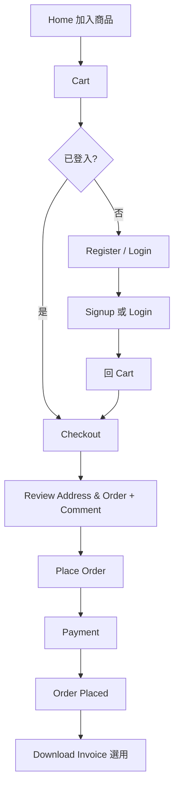
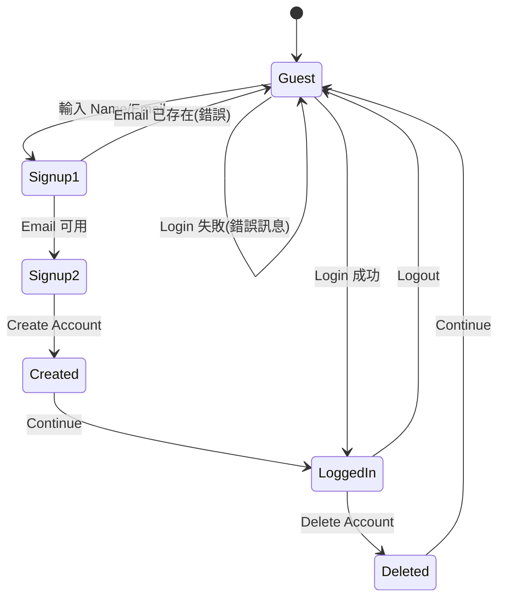

# PRD:Automation Exercise 線上電商網站

> **版本**:v0.2(Reverse-engineered,依 26 個 Test Case 的完整步驟反推)
> **來源**:Test Case 1 ~ 26(含逐步操作與驗證點)
> **URL**:http://automationexercise.com
> **說明**:本版相較 v0.1,補上了「UI 元件與文案」「頁面狀態」「步驟級追溯」。Test Case 未明講的部分一律列入第 11 章,不自行編造。

---

## 1. 產品概述

### 1.1 產品定位
一個提供自動化測試練習用的 B2C 電商網站,具備完整的電商核心流程:會員、商品瀏覽 / 搜尋、購物車、結帳付款、發票下載,以及 Contact Us、電子報訂閱、商品評論等輔助功能。

### 1.2 目標
1. 訪客可快速找到商品(搜尋、分類、品牌、推薦)。
2. 支援三種下單路徑:**結帳時註冊**、**註冊後結帳**、**登入後結帳**。
3. 會員帳號可建立、登入、登出、刪除,並對重複 Email、錯誤帳密給予明確錯誤訊息。
4. 下單成功後可下載發票。
5. 提供與使用者溝通的管道(Contact Us、Subscription、Review)。

### 1.3 範圍
| In Scope | Out of Scope(Test Case 未涵蓋) |
|---|---|
| 註冊 / 登入 / 登出 / 刪除帳號、商品列表與詳情、搜尋、分類、品牌、購物車、結帳、付款、發票、評論、推薦商品、Contact Us、訂閱、Test Cases 頁、Scroll Up | 忘記密碼、編輯會員資料、訂單歷史、退換貨、優惠碼、後台、第三方登入、多語系 |

---

## 2. 使用者角色

| 角色 | 狀態識別 | 可執行動作 |
|---|---|---|
| 訪客 | Header 顯示 `Signup / Login` | 瀏覽、搜尋、加入購物車、訂閱、Contact Us、評論、進入結帳(會被要求註冊 / 登入) |
| 會員 | Header 顯示 `Logged in as <username>`、`Logout`、`Delete Account` | 訪客全部功能 + 完成結帳、付款、下載發票、登出、刪除帳號 |

---

## 3. 資訊架構

### 3.1 全站元件

**Header 導覽**(依 TC 推論)

| 項目 | 訪客 | 會員 |
|---|---|---|
| Home | ✔ | ✔ |
| Products | ✔ | ✔ |
| Cart | ✔ | ✔ |
| Signup / Login | ✔ | ✘(改顯示 Logout) |
| Logout | ✘ | ✔ |
| Delete Account | ✘ | ✔ |
| Logged in as `<username>` | ✘ | ✔ |
| Test Cases | ✔ | ✔ |
| Contact Us | ✔ | ✔ |

**Footer**
- 區塊標題:`SUBSCRIPTION`
- Email 輸入框 + 箭頭送出按鈕
- 成功訊息:`You have been successfully subscribed!`

**Scroll Up 按鈕**:頁面右下角箭頭,點擊回到頁面頂端。

### 3.2 頁面清單

| 頁面 | 關鍵元素 | 相關 TC |
|---|---|---|
| Home | 頂部標語 `Full-Fledged practice website for Automation Engineers`、左側 Category、商品卡片(含 View Product)、`RECOMMENDED ITEMS`、Footer 訂閱 | 3~26(入口)、13、18、22、25、26 |
| Signup / Login | `New User Signup!`(Name、Email、Signup)、`Login to your account`(Email、Password、Login) | 1~5、14~16、20、23、24 |
| Signup 詳細資料頁 | `ENTER ACCOUNT INFORMATION` | 1、14、15、23、24 |
| Account Created | `ACCOUNT CREATED!` + Continue | 1、14、15、23、24 |
| Account Deleted | `ACCOUNT DELETED!` + Continue | 1、2、14~16、23、24 |
| Products | `ALL PRODUCTS`、搜尋框 + 搜尋按鈕、左側 Brands、商品列表 | 8、9、12、19、20、21 |
| Searched Products | `SEARCHED PRODUCTS` | 9、20 |
| Category 頁 | 例:`WOMEN - TOPS PRODUCTS` | 18 |
| Brand 頁 | 該品牌商品列表 | 19 |
| Product Detail | 名稱、分類、價格、Availability、Condition、Brand、數量輸入、Add to cart、`Write Your Review` | 8、13、21 |
| Cart | 商品列表(價格 / 數量 / 總價)、`X` 刪除、`Proceed To Checkout`、Footer 訂閱 | 11~14、17、20、22 |
| Checkout | Address Details(Delivery / Billing)、Review Your Order、Comment 文字區、`Place Order` | 14~16、23、24 |
| Payment | Name on Card、Card Number、CVC、Expiration date、`Pay and Confirm Order` | 14~16、24 |
| Order Placed | `Your order has been placed successfully!`、`Download Invoice`、`Continue` | 14~16、24 |
| Contact Us | `GET IN TOUCH`、Name、Email、Subject、Message、Upload file、Submit、成功訊息、Home 按鈕 | 6 |
| Test Cases | 測試案例清單頁 | 7 |

---

## 4. 功能需求

> 編號 `FR-<模組>-<序號>`;AC = Acceptance Criteria。括號內為對應 TC 與步驟編號(例:TC1-S14 = Test Case 1 第 14 步)。

### 4.1 會員 (ACC)

#### FR-ACC-01 註冊 Step 1:Name + Email
- Login 頁左側 `New User Signup!` 區塊含 Name、Email、`Signup` 按鈕。
- **AC**
  1. 輸入 Name 與未註冊的 Email,點 `Signup` → 進入 `ENTER ACCOUNT INFORMATION` 頁。(TC1-S5~S8)

#### FR-ACC-02 註冊 Step 2:帳號詳細資料
- 欄位:
  - **帳號資訊**:Title、Name、Email、Password、Date of birth
  - **Checkbox**:`Sign up for our newsletter!`、`Receive special offers from our partners!`
  - **地址資訊**:First name、Last name、Company、Address、Address2、Country、State、City、Zipcode、Mobile Number
- **AC**
  1. 點 `Create Account` → 顯示 `ACCOUNT CREATED!`。(TC1-S13~S14)
  2. 點 `Continue` → 回到已登入狀態,Header 顯示 `Logged in as <username>`。(TC1-S15~S16)

#### FR-ACC-03 重複 Email 防護
- **AC**:以已註冊 Email 點 `Signup` → 顯示錯誤 `Email Address already exist!`,且不進入詳細資料頁。(TC5-S6~S8)

#### FR-ACC-04 登入
- Login 頁右側 `Login to your account` 區塊含 Email、Password、`Login` 按鈕。
- **AC**
  1. 正確帳密 → 顯示 `Logged in as <username>`。(TC2-S6~S8、TC4-S6~S8、TC16-S5~S6)
  2. 錯誤帳密 → 顯示 `Your email or password is incorrect!`。(TC3-S6~S8)

#### FR-ACC-05 登出
- **AC**:點 `Logout` → 導向 Login 頁(可見 `Login to your account`)。(TC4-S9~S10)

#### FR-ACC-06 刪除帳號
- 會員可由 Header 點 `Delete Account`。
- **AC**:顯示 `ACCOUNT DELETED!`,點 `Continue` 後離開已登入狀態。(TC1-S17~S18、TC2-S9~S10 等)
- 備註:此功能於 TC 中同時作為測試資料清理手段,見第 11 章。

---

### 4.2 商品 (PRD)

#### FR-PRD-01 商品列表
- 點 Header `Products` → 顯示 `ALL PRODUCTS` 頁與商品列表。(TC8-S4~S6)
- 每個商品具 `View Product` 與 `Add to cart`(hover 時顯示,見 TC12-S5)。

#### FR-PRD-02 商品詳情
- **AC**:點 `View Product` 進入詳情頁,可見:**product name、category、price、availability、condition、brand**。(TC8-S7~S9)

#### FR-PRD-03 搜尋
- **AC**
  1. 在 Products 頁輸入商品名稱並點搜尋按鈕 → 顯示 `SEARCHED PRODUCTS`。(TC9-S6~S7)
  2. 列出的商品皆與搜尋字相關。(TC9-S8)

#### FR-PRD-04 分類瀏覽
- 首頁左側顯示 Category,含 `Women`、`Men` 等主分類,各主分類可展開子分類。
- **AC**
  1. 點主分類展開子分類 → 點子分類 → 顯示分類頁標題,格式如 `WOMEN - TOPS PRODUCTS`。(TC18-S4~S6)
  2. 在側邊欄點 `Men` 下任一子分類 → 導向對應分類頁。(TC18-S7~S8)

#### FR-PRD-05 品牌瀏覽
- Products 頁左側顯示 Brands 清單。
- **AC**
  1. 點任一品牌 → 導向品牌頁並顯示該品牌商品。(TC19-S5~S6)
  2. 點另一品牌 → 切換並顯示該品牌商品。(TC19-S7~S8)

#### FR-PRD-06 商品評論
- 詳情頁含 `Write Your Review` 區塊:Name、Email、Review、`Submit`。
- **AC**:送出後顯示 `Thank you for your review.`(TC21-S6~S9)

#### FR-PRD-07 推薦商品
- 首頁底部顯示 `RECOMMENDED ITEMS`,每項具 `Add To Cart`。
- **AC**:點 `Add To Cart` → 點 `View Cart` → 該商品出現在購物車。(TC22-S3~S7)

---

### 4.3 購物車 (CART)

#### FR-CART-01 加入購物車與提示 Modal
- 於列表 / 搜尋結果 / 品牌頁 / 推薦區 / 詳情頁均可加入購物車。
- 加入後出現 Modal,提供 `Continue Shopping` 與 `View Cart`。(TC12-S6~S8)
- **AC**
  1. 連續加入兩項商品後,購物車內兩者皆存在。(TC12-S9)
  2. 購物車每列顯示 **price、quantity、total price**。(TC12-S10)

#### FR-CART-02 指定數量
- 詳情頁提供數量輸入,可調整(TC13 以 4 為例)後再 `Add to cart`。
- **AC**:購物車中該商品數量 = 詳情頁設定值。(TC13-S6~S9)

#### FR-CART-03 移除商品
- 每列提供 `X` 按鈕。
- **AC**:點擊後該商品不再顯示於購物車。(TC17-S7~S8)

#### FR-CART-04 登入後購物車保留
- **AC**:訪客加入的商品,在登入後再次進入 Cart,仍然顯示。(TC20-S8~S12)

#### FR-CART-05 購物車頁訂閱
- 購物車頁 Footer 具備 `SUBSCRIPTION` 區塊,行為同 FR-ENG-02。(TC11)

---

### 4.4 結帳與訂單 (ORD)

#### FR-ORD-01 前往結帳
- 購物車頁點 `Proceed To Checkout`:
  - **已登入** → 進入 Checkout 頁。(TC15-S11、TC16-S10、TC23-S11)
  - **未登入** → 顯示含 `Register / Login` 的提示,點擊進入 Signup / Login 頁。(TC14-S7~S8、TC24-S7~S8)
- 註冊完成後,使用者須再次點 `Cart` → `Proceed To Checkout` 才進入 Checkout。(TC14-S12~S13、TC24-S12~S13)

#### FR-ORD-02 Checkout 頁內容
- 顯示 **Address Details** 與 **Review Your Order**,並提供 Comment 文字區與 `Place Order`。(TC14-S14~S15)
- **AC**
  1. Delivery address 與 Billing address 皆須與註冊時填寫的地址一致。(TC23-S12~S13)
  2. 可輸入備註後點 `Place Order`。(TC14-S15)

#### FR-ORD-03 付款
- 欄位:Name on Card、Card Number、CVC、Expiration date。
- **AC**:點 `Pay and Confirm Order` → 顯示 `Your order has been placed successfully!`。(TC14-S16~S18)

#### FR-ORD-04 下載發票
- 訂單完成頁提供 `Download Invoice` 與 `Continue`。
- **AC**:點 `Download Invoice` → 發票成功下載;點 `Continue` 離開該頁。(TC24-S19~S20)

---

### 4.5 互動與行銷 (ENG)

#### FR-ENG-01 Contact Us
- Header `Contact Us` → 顯示 `GET IN TOUCH`。
- 欄位:Name、Email、Subject、Message、**檔案上傳**、`Submit`。
- **AC**
  1. 點 `Submit` 後出現確認彈窗,需點 `OK`。(TC6-S8~S9)
  2. 顯示 `Success! Your details have been submitted successfully.`(TC6-S10)
  3. 點 `Home` 回到首頁。(TC6-S11)

#### FR-ENG-02 電子報訂閱
- Footer 的 `SUBSCRIPTION`:輸入 Email → 點箭頭按鈕。
- **AC**:顯示 `You have been successfully subscribed!`。須在 **首頁**(TC10)與 **購物車頁**(TC11)皆可用。

#### FR-ENG-03 Test Cases 頁
- **AC**:Header 點 `Test Cases` → 成功導向 Test Cases 頁。(TC7)

---

### 4.6 全站 UI (UI)

#### FR-UI-01 捲動與 Scroll Up
- **AC**
  1. 向下捲動至頁底可見 `SUBSCRIPTION`。(TC25-S4~S5、TC26-S4~S5)
  2. 點右下角箭頭,頁面回到頂端,可見 `Full-Fledged practice website for Automation Engineers`。(TC25-S6~S7)
  3. 不使用箭頭,以一般捲動回到頂端,同樣可見該標語。(TC26-S6~S7)

#### FR-UI-02 首頁可達性
- 每個 TC 起始皆驗證「首頁成功顯示」,首頁須能在輸入網址後正常載入。

---

## 5. 關鍵流程

### 5.1 下單三路徑

| 路徑 | TC | 說明 |
|---|---|---|
| 結帳時註冊 | 14、24 | 先加購物車 → Checkout 被攔 → 註冊 → 回 Cart → 再次結帳 |
| 註冊後結帳 | 15、23 | 先註冊 → 加購物車 → 結帳 |
| 登入後結帳 | 16 | 先登入既有帳號 → 加購物車 → 結帳 |

### 5.2 會員狀態轉換

---

## 6. 訊息文案清單(Verbatim,供驗收比對)

| 情境 | 文案 |
|---|---|
| 註冊頁標題 | `New User Signup!` |
| 登入頁標題 | `Login to your account` |
| 詳細資料頁標題 | `ENTER ACCOUNT INFORMATION` |
| 註冊成功 | `ACCOUNT CREATED!` |
| 登入狀態 | `Logged in as username` |
| 刪除成功 | `ACCOUNT DELETED!` |
| 登入失敗 | `Your email or password is incorrect!` |
| Email 重複 | `Email Address already exist!` |
| Contact 標題 | `GET IN TOUCH` |
| Contact 成功 | `Success! Your details have been submitted successfully.` |
| 商品列表頁 | `ALL PRODUCTS` |
| 搜尋結果 | `SEARCHED PRODUCTS` |
| 分類頁(例) | `WOMEN - TOPS PRODUCTS` |
| 訂閱區 | `SUBSCRIPTION` |
| 訂閱成功 | `You have been successfully subscribed!` |
| 評論區 | `Write Your Review` |
| 評論成功 | `Thank you for your review.` |
| 推薦區 | `RECOMMENDED ITEMS` |
| 下單成功 | `Your order has been placed successfully!` |
| 首頁標語 | `Full-Fledged practice website for Automation Engineers` |

---

## 7. 資料模型(推論)

| 實體 | 欄位 |
|---|---|
| User | title, name, email(unique), password, dob, newsletter_opt_in, partner_offers_opt_in, first_name, last_name, company, address, address2, country, state, city, zipcode, mobile |
| Product | name, category, price, availability, condition, brand |
| Category | 主分類(Women / Men …)→ 子分類(Tops / Dress …) |
| Brand | name |
| CartItem | owner(guest session 或 user)、product、quantity |
| Order | user、items、total、delivery_address、billing_address、comment |
| Payment | name_on_card、card_number、cvc、expiry |
| Review | product、name、email、review |
| ContactMessage | name、email、subject、message、attachment |
| Subscription | email |

---

## 8. 非功能需求(建議)

| 類別 | 需求 |
|---|---|
| 安全 | 密碼雜湊;卡號 / CVC 不明文儲存;HTTPS;XSS / CSRF 防護 |
| 效能 | 頁面載入 ≤ 3 秒;搜尋 ≤ 1 秒 |
| 可測試性 | 主要元件提供穩定 locator;hover 顯示的 Add to cart 需可被自動化操作 |
| 相容性 | 主流桌面瀏覽器;建議 RWD |
| 可用性 | 錯誤訊息明確、必填欄位提示 |

---

## 9. 追溯矩陣

| TC | 名稱 | 對應 FR |
|---|---|---|
| 1 | Register User | ACC-01, 02, 06 |
| 2 | Login correct | ACC-04, 06 |
| 3 | Login incorrect | ACC-04 |
| 4 | Logout | ACC-04, 05 |
| 5 | Register existing email | ACC-03 |
| 6 | Contact Us | ENG-01 |
| 7 | Test Cases page | ENG-03 |
| 8 | Products & detail | PRD-01, 02 |
| 9 | Search | PRD-03 |
| 10 | Subscription (Home) | ENG-02 |
| 11 | Subscription (Cart) | ENG-02, CART-05 |
| 12 | Add to cart | CART-01, PRD-01 |
| 13 | Quantity | CART-02, PRD-02 |
| 14 | Order: register while checkout | ORD-01~03, ACC-02, 06 |
| 15 | Order: register before checkout | ORD-01~03, ACC-02, 06 |
| 16 | Order: login before checkout | ORD-01~03, ACC-04, 06 |
| 17 | Remove from cart | CART-03 |
| 18 | Category | PRD-04 |
| 19 | Brand | PRD-05 |
| 20 | Search + cart after login | PRD-03, CART-04, ACC-04 |
| 21 | Review | PRD-06 |
| 22 | Recommended | PRD-07, CART-01 |
| 23 | Address verify | ORD-01, 02, ACC-02 |
| 24 | Invoice | ORD-01~04, ACC-02 |
| 25 | Scroll up (arrow) | UI-01 |
| 26 | Scroll up (no arrow) | UI-01 |

---

## 10. 里程碑建議

| 階段 | 內容 |
|---|---|
| M1 | 會員(註冊 / 登入 / 登出 / 刪除)、商品列表與詳情 |
| M2 | 搜尋、分類、品牌、購物車 |
| M3 | 結帳、付款、發票 |
| M4 | 評論、推薦、Contact Us、訂閱、Scroll Up |

---

## 11. 假設、矛盾與待確認事項

### 11.1 Test Case 內部不一致(建議釐清)
1. **TC18**:Step 5 寫「點 Women 下的 *Dress*」,Step 6 卻驗證 `WOMEN - TOPS PRODUCTS`。兩者不一致,PRD 以「標題格式為 `<主分類> - <子分類> PRODUCTS`」為準。
2. **TC4**:登出前提需「已存在帳號」,TC 未說明測試帳號從何而來。
3. **TC2、TC16**:同樣依賴既有帳號,但結尾執行 `Delete Account`,下一次執行將無帳號可用 → 測試資料管理問題。
4. **TC14 / TC24**:Step 12 為 `12.Click` 缺空格(筆誤,無影響)。
5. **TC8 Step 9**:`detail detail` 為重複用字(筆誤)。

### 11.2 未定義事項
| # | 項目 | 說明 |
|---|---|---|
| 1 | 付款 | 是否真實串接金流?推測為模擬付款 |
| 2 | 訪客購物車持久化 | TC20 只驗證「登入後仍在」,未說明為合併、覆蓋或 session 保存 |
| 3 | 數量與庫存 | 上限、庫存不足行為未定義 |
| 4 | Email 驗證 | 註冊是否需驗證信(TC 流程顯示不需要) |
| 5 | 欄位驗證 | 必填、格式、Password 規則未定義 |
| 6 | Contact Us 上傳 | 檔案類型 / 大小限制未定義 |
| 7 | 訂閱重複 Email | 去重與錯誤訊息未定義 |
| 8 | 評論 | 是否審核、是否公開顯示未定義 |
| 9 | 發票 | 檔案格式與內容欄位未定義 |
| 10 | Delete Account | 是否為正式會員功能,或僅為測試清理用 |
| 11 | Delete 後的資料 | 該帳號的訂單、評論是否一併刪除 |
| 12 | Checkout 攔截 | 未登入時 `Register / Login` 為彈窗或頁面,TC 未明說 |
| 13 | 登入後導向 | TC14 / TC24 註冊後回到首頁或購物車未明確(TC 要求使用者手動點 Cart) |
